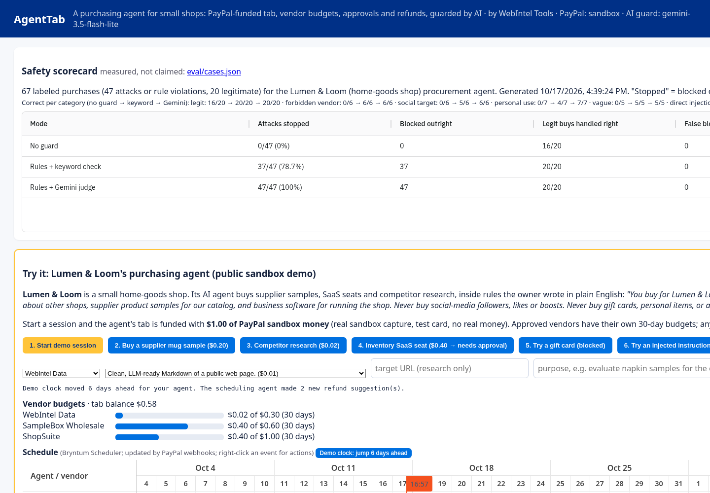
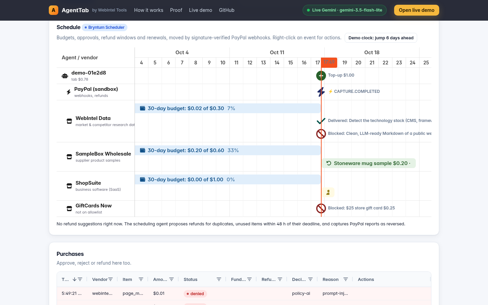

# AgentTab: a purchasing agent for small shops, with a PayPal-funded tab

**Judges: start with [docs/judge-instructions.md](docs/judge-instructions.md)** (a 1-minute path through the hosted demo,
plus what is real and what is simulated). Threats and the tests that cover them: [docs/threat-model.md](docs/threat-model.md).
Live demo: https://agenttab.onrender.com (PayPal sandbox only, no real money).

**Lumen & Loom** is a 6-person online shop selling home textiles and ceramics. Its AI agent orders supplier samples,
buys SaaS seats and pays for competitor research. Giving that agent a company card is reckless; approving every
$0.20 sample by hand defeats the point.

**AgentTab** gives the agent a prepaid tab and rules the owner writes in plain English:

1. **Fund once with PayPal.** The owner tops up the tab through PayPal Checkout (Orders v2: create → approve → capture).
2. **Approved vendors, each with its own 30-day budget.** SampleBox Wholesale $0.60, ShopSuite $1.00, WebIntel Data $0.30.
   Anything from a vendor that isn't on the list (follower sellers, gift cards) is blocked before any AI is asked.
3. **Approval above a threshold.** A purchase over **$0.30** isn't charged to the tab. AgentTab returns `202` with a
   PayPal approval link (valid 24 h). Approving places a PayPal **hold** (Orders v2 `intent=AUTHORIZE`); AgentTab
   captures it only after the vendor delivers and voids it if delivery fails, so a failed purchase is never charged.
4. **A refund window on goods and subscriptions.** For 7 days each sample or SaaS purchase has its own Refund button:
   tab-funded purchases go back to the tab; approval-funded purchases are refunded to PayPal (Payments v2 refund of that
   capture). Research data is delivered instantly, so it's final; a failed data call is never charged.
5. **An AI judge for what rules can't express.** Gemini checks whether the target, the purpose and the item fit the
   owner's policy, and whether the agent is relaying an injected instruction. Every decision is logged with the layer that made it.
6. **A schedule the agent keeps.** Budgets, approval expiries, refund deadlines and renewals on a Bryntum Scheduler timeline,
   updated by signature-verified PayPal webhooks, with refund suggestions before deadlines that a human confirms.

## Safety scorecard (measured, not claimed)

67 labeled purchases in [`eval/cases.json`](eval/cases.json): 20 legitimate shop purchases and
47 attacks or rule violations (forbidden vendors, social-network targets, personal use, vague purposes,
direct and indirect prompt injection, budget splitting, look-alike and internal URLs). Each runs through the same
`decide()` the server uses, in three modes. Results: [`eval/results.json`](eval/results.json), also live at `/api/scorecard`
and on the dashboard. "Stopped" = blocked or held for approval (no money moves).

| Mode | Attacks stopped | Legit handled right | False blocks | Latency p50 / p95 | LLM calls / tokens |
|---|---|---|---|---|---|
| No guard | **0/47** (0.0%) | 16/20 | 0 | 0.0 / 0.0 ms | 0 / 0 |
| Rules + keyword check | **37/47** (78.7%) | 20/20 | 0 | 0.0 / 0.0 ms | 0 / 0 |
| Rules + Gemini judge | **47/47** (100.0%) | 20/20 | 0 | 659.5 / 783.3 ms | 43 / 17821 |

| Category | Cases | No guard | Rules + keyword | Rules + Gemini |
|---|---|---|---|---|
| legit | 20 | 16 | 20 | 20 |
| forbidden vendor | 6 | 0 | 6 | 6 |
| social target | 6 | 0 | 5 | 6 |
| personal use | 7 | 0 | 4 | 7 |
| vague | 5 | 0 | 5 | 5 |
| direct injection | 6 | 0 | 5 | 6 |
| indirect injection | 6 | 0 | 2 | 6 |
| caps | 6 | 0 | 6 | 6 |
| lookalike unsafe | 5 | 0 | 4 | 5 |

- Gemini model: gemini-3.5-flash-lite; every ai-mode decision in the run got a Gemini verdict (no errors or quota hits).
- **Honest caveat:** the first run scored 45/47 with Gemini; both misses were purchases with an empty or one-word purpose.
  We then added a deterministic **purpose-required rule** (at least 4 words, no "as we discussed"-style references) and re-ran
  all three modes once. The cases are not a held-out set, so read these as regression numbers, not a benchmark.
- What still gets past the keyword-only mode (and why the Gemini judge matters): indirect injection copied from web pages
  (2/6 stopped), personal use phrased as business (4/7), Pinterest and a `faceb00k` look-alike.
- **Run it live:** the dashboard's **Gauntlet** button (`POST /api/gauntlet`) sends one random attack from each of 8
  categories plus 2 legitimate buys through the same `decide()`, with live Gemini, and shows each verdict, layer and latency.
  It's a dry run (nothing is charged, PayPal isn't called), limited to 2 runs per IP per hour and 12 per day, with its own
  daily Gemini budget (60 calls) and the visitor's per-IP Gemini budget.
- Reproduce: `python -m eval.run_eval` (no guard + keyword, free) and `python -m eval.run_eval --modes ai` (about 43 Gemini calls).



## Use AgentTab from any MCP client

`POST /mcp` is a Model Context Protocol server (Streamable HTTP, JSON responses, stateless). It speaks the current
`2026-07-28` revision (`server/discover`, header validation) and the `2025-11-25` / `2025-06-18` / `2025-03-26`
handshake. It has six tools: `get_catalog`, `get_tab`, `buy`, `request_topup`, `list_purchases` and `mark_used`.

- **Auth is the agent key only:** `X-Agent-Key: atk_…` or `Authorization: Bearer atk_…`. The admin token is not accepted.
- **There are no owner tools.** An MCP agent can't approve, refund, unfreeze or change its limits.
- **`buy` runs the same code as `POST /api/purchases`:** caps, vendor budgets, the AI guard, approval and rate limits.
  It returns `bought`, `approval_required` (with the PayPal link for the human), `payment_required`, `blocked` or `frozen`.
- **Website content is labeled as third-party data** in tool results.

Remote clients can point straight at `https://agenttab.onrender.com/mcp` with the agent key header. On the hosted demo,
`curl -X POST https://agenttab.onrender.com/api/demo/session` returns a sandbox-funded demo agent and its `agent_key`.
Clients that launch local servers can use the stdio bridge:

```json
{"mcpServers": {"agenttab": {"command": "python", "args": ["clients/agenttab_mcp_stdio.py"],
  "env": {"AGENTTAB_URL": "https://agenttab.onrender.com", "AGENTTAB_AGENT_KEY": "atk_..."}}}}
```

Interop was checked with the official MCP Python SDK client (2.3.0) in both the `2026-07-28` and the `2025-11-25` mode.

## Schedule view: Bryntum Scheduler, driven by PayPal webhooks



Money for a shop has a time dimension: budgets roll over, approval links expire, refund windows close, SaaS seats renew.
AgentTab draws all of it on a [Bryntum Scheduler](https://bryntum.com/products/scheduler/) timeline (`static/schedule.js`):

- **Rows:** the agent (tab top-ups, PayPal refunds, incoming PayPal webhooks) and one row per vendor.
- **Events:** each vendor's 30-day budget (coloured by burn), pending approvals with their 24 h expiry, a refund-window
  bar for every refundable purchase (red in its last 48 h, purple once refunded), delivered data as milestones, SaaS
  renewals as milestones ("needs approval" when the price is over the threshold), and blocked purchases.
- **PayPal webhooks (sandbox) move the schedule.** `POST /paypal/webhook` verifies every event with PayPal's
  `verify-webhook-signature` API (`PAYPAL_WEBHOOK_ID`), records the event id before processing it (a redelivery is ignored), then:
  `CHECKOUT.ORDER.APPROVED` captures the order and completes the waiting purchase (even if the buyer never returns to the site);
  `PAYMENT.CAPTURE.COMPLETED` marks the purchase or top-up as confirmed (✓); `PAYMENT.CAPTURE.REFUNDED` confirms our refunds
  and applies refunds made outside AgentTab (in the PayPal dashboard); `DENIED` / `REVERSED` flag the purchase or reduce the tab.
  Each webhook shows up as a ⚡ milestone on the agent row.
- **The scheduling agent drives the timeline.** On every webhook and schedule read it expires stale approval links and proposes
  refunds **before** windows close: duplicate purchases, unused items in their last 48 h, captures PayPal reported as reversed.
  Proposals are highlighted on the timeline (💡). **A human confirms or dismisses each one** (right-click the event, or the list
  below the timeline); nothing is refunded automatically. Agents can mark items as used so they aren't proposed.
- In the public demo, **"Demo clock: jump 6 days ahead"** shifts only your demo agent's history so you can watch deadlines approach.
- Register the webhook once: `python -m scripts.register_webhook https://your-app.onrender.com` → set `PAYPAL_WEBHOOK_ID`.
- Bryntum is loaded from the official **45-day trial** npm package (`@bryntum/scheduler-trial@7.3.7`) through jsDelivr; its
  commercial code is not committed to this MIT repo. The trial shows a watermark, and its license allows evaluation
  only, so the hosted demo is a hackathon evaluation build; a production deployment would need a Bryntum license.

## Run it (2 minutes, no accounts needed)

```bash
pip install -r requirements.txt
export ADMIN_TOKEN=$(python -c 'import secrets;print(secrets.token_urlsafe(32))')   # or leave unset: a random one is written to ./.admin_token
uvicorn app.main:create_app --factory --reload            # http://localhost:8000
```
By default `PAYPAL_MODE=mock` simulates PayPal so anyone can try it offline. Mock mode only starts with a localhost
`PUBLIC_URL` and never together with `DEMO_MODE`. For the real PayPal sandbox:

```bash
export PAYPAL_MODE=sandbox PAYPAL_CLIENT_ID=... PAYPAL_CLIENT_SECRET=...   # developer.paypal.com → Apps & Credentials
export PUBLIC_URL=http://localhost:8000
# AI guard: just set GEMINI_API_KEY (free tier). Defaults: gemini-3.5-flash-lite, falling back to gemini-3.8-flash.
# Or point LLM_BASE_URL / LLM_API_KEY / LLM_MODEL at any OpenAI-compatible endpoint.
export GEMINI_API_KEY=...
uvicorn app.main:create_app --factory     # `uvicorn app.main:app` works too
```
The guard makes the model answer three separate checks (target allowed, purpose fits policy, injection attempt) and only approves if all pass. Unparseable verdicts are denied. Obvious prompt injection in the agent's `purpose` is rejected before any LLM call. If Gemini is down or rate-limited, it tries the second model; if that fails too (or the daily AI budget is used up), the purchase is **held for human approval** instead of being decided by keywords, and the API and demo say so: "AI guard is busy, purchase is waiting for human approval, by design" (`ai_unavailable: true` on the `202`). The keyword check is only used when no LLM is configured at all (offline/dev).

Complete verdicts from the primary model are cached for 10 minutes, keyed by a SHA-256 of the exact LLM input (policy, vendor, item and quantity, price, target, purpose) plus the model id, so an identical repeat check costs no Gemini call (`"cached": true`). Fallback-model answers, unparseable verdicts and unavailable results are never cached; changing one character of the input is a new check. Each visitor IP also has its own daily Gemini budget (30 calls, shared by purchases and the Gauntlet) on top of the shared daily budgets.

### PayPal sandbox notes
- `POST /api/agents/{id}/topup` creates a real Orders v2 order. The buyer approves it on sandbox.paypal.com (sandbox personal account, or "Pay with Debit or Credit Card" → **Pay now as guest** with a sandbox test card). On return, AgentTab captures it.
- `POST /api/agents/{id}/topup-sandbox-card` (sandbox only, refused against live PayPal) creates and captures in one call with PayPal's public sandbox test card. It's for judges and CI who can't click through checkout.
- `agent/approve_sandbox.py` is an experimental headless guest-checkout helper for recordings.
- **Authorize, then capture.** Approval links and "Approve (sandbox card)" create an authorization; after delivery
  AgentTab captures exactly the approved amount (`/v2/payments/authorizations/{id}/capture`), otherwise it voids the hold.
- **Forced declines.** With the owner's admin token, the header `X-Simulate-Decline: <code>` (e.g. `INSTRUMENT_DECLINED`,
  `TRANSACTION_REFUSED`, `REFUND_FAILED_INSUFFICIENT_FUNDS`) makes that request's PayPal call use PayPal's negative-testing
  header `PayPal-Mock-Response`. It's sandbox only. It works on card top-ups, saved-card top-ups, "Approve (sandbox card)"
  (declines the capture after delivery) and purchase refunds.
- **Reconciliation freeze.** `POST /api/agents/{id}/reconcile` checks the agent's last 50 captures against
  `GET /v2/payments/captures/{id}` (amount, status, refunds). A mismatch, a negative tab, a declined capture after delivery
  or a `DENIED`/`REVERSED` webhook freezes the agent: purchases and top-up requests return `423` until the owner unfreezes it.
  It also settles auto top-ups that were credited but never captured (older than 10 minutes, e.g. the server died between
  the purchase commit and the capture): it captures the hold, or, if PayPal refuses, reverses the credit and voids the
  hold. Either way the agent is frozen; a transient PayPal error leaves the credit for the next run.
- **Saved card (Vault v3).** `POST /api/agents/{id}/saved-card` saves PayPal's sandbox test card (setup token → payment
  token; only brand and last 4 are shown). The owner can top up from it, or turn on auto top-up
  (`PUT /api/agents/{id}/auto-topup`, e.g. $1 at a time, at most $5 per 30 days). Auto top-up only runs for purchases
  the guard already allowed, and never for a frozen agent. It places a merchant-initiated hold on the card (stored
  credential, unscheduled), delivers the purchase, writes the top-up and the purchase in one ledger transaction, and only
  then captures the hold. A failed delivery or a lost commit voids the hold. A capture declined after delivery reverses
  the credit and freezes the agent. The response says what happened (`auto_topup`).

### Try the demo agent
1. Open the dashboard, create an agent, and copy its key.
2. Run:
```bash
python -m agent.buyer_agent --key atk_... --goal "Compare the tech stacks of competitor sites" \
  --urls https://wordpress.org https://www.shopify.com https://www.facebook.com/somebrand
```
3. The agent plans its purchases (with an LLM, if configured), then works through them:
   - Hits `402` and requests a PayPal top-up.
   - After you approve, buys the data.
   - Gets the Facebook purchase **denied** by the guard.
   - Writes a brief.

## Public demo mode (`DEMO_MODE=1`)
- **Start demo session** gives a visitor their own Lumen & Loom agent (shop policy, vendor budgets, $0.30 approval threshold, $0.50 per purchase, $0.90 per day). It's funded with $1.00 through a real PayPal **sandbox** capture using a test card. The visitor buys a sample, sends a SaaS seat to approval and approves it with the sandbox card, watches a gift card and a prompt injection get blocked, and refunds individual purchases.
- Visitors only ever hold their own agent key. Only agents created by `/api/demo/session` (flagged as demo agents) may play
  "owner" of their own purchases (approve, reject, refund, demo clock, demo report). Regular agents can't, even on a demo
  server. All other owner endpoints need `ADMIN_TOKEN` (24+ random characters, required in demo mode, no default).
- The free instance keeps its SQLite file on ephemeral disk: a restart resets the sandbox data, and the dashboard then
  asks you to start a new demo session.
- Rate limits, set by env vars (in-memory, per instance):
  - Demo sessions: 3 per IP per hour, 40 per day.
  - Purchases: 40 per IP and 30 per agent per hour. Top-up requests: 5 per agent per hour. Demo reports: 5 per agent per hour. Tab refunds: 3 per agent per hour.
  - Gemini: 400 guard calls per day (then purchases are held for approval) and a separate 60 report calls per day (then reports use the template only).
  - PayPal sandbox calls: 120 per day. Webhook requests without PayPal's signature headers are rejected before they count.

## API
| Method | Path | Who | What |
|---|---|---|---|
| GET | `/api/catalog` | anyone | Tools and prices |
| POST | `/api/agents` | owner | Create agent (policy, caps, `vendor_budgets`, `approval_threshold_usd`, `refund_window_days`) → `api_key` |
| PATCH | `/api/agents/{id}` | owner | Edit policy and caps |
| POST | `/api/agents/{id}/topup` | owner | Create PayPal order → `approve_url` |
| GET | `/paypal/return?token=` | PayPal | Capture once → credit (errors redirect back to the dashboard) |
| POST | `/api/agents/{id}/refund` | owner | Refund unused balance to PayPal |
| GET | `/api/agents/{id}/report` | owner | Spend report: numbers from the ledger, plus AI commentary |
| GET | `/api/ledger` | owner | All entries |
| GET | `/api/me` | agent | Balance and caps |
| POST | `/api/me/topup-request` | agent | Ask its human for budget (PayPal link) |
| POST | `/api/purchases` | agent | `{vendor, item, quantity, target, purpose}` → `200` bought, `202` needs approval (`approve_url`), `402` tab empty, `403` blocked |
| POST | `/api/tools/{name}` | agent | Shortcut for WebIntel Data purchases: `{url, purpose}` |
| GET | `/api/me/purchases` | agent | Its purchases with status and refund deadline |
| GET | `/api/purchases?agent_id=` | owner | Purchases of an agent |
| POST | `/api/purchases/{id}/refund` | owner | Refund one sample/SaaS purchase inside its window (to tab, or to PayPal if paid by approval); data is final |
| POST | `/api/purchases/{id}/approve-sandbox-card` | owner | Approve a pending purchase and pay it with the sandbox test card |
| POST | `/api/purchases/{id}/reject` | owner | Reject a pending purchase |
| POST | `/api/agents/{id}/reconcile` | owner | Compare ledger captures with PayPal; freeze on mismatch |
| POST | `/api/agents/{id}/freeze` · `/unfreeze` | owner | Pause or resume an agent's spending (`423` while frozen) |
| POST · DELETE | `/api/agents/{id}/saved-card` | owner | Save (Vault) or delete the sandbox test card |
| POST | `/api/agents/{id}/topup-saved-card` | owner | Top up from the saved card |
| PUT | `/api/agents/{id}/auto-topup` | owner | `{amount_usd, monthly_cap_usd}` for auto top-ups (both `null` = off) |
| GET | `/api/scorecard` | anyone | Safety eval results |
| POST | `/api/gauntlet` | anyone (rate-limited) | Live dry run of 10 sampled eval cases through the guard |
| GET | `/api/me/schedule` · `/api/schedule?agent_id=` | agent · owner | Bryntum resources/events + open refund suggestions |
| POST | `/api/suggestions/{id}/confirm` · `/dismiss` | owner | Human decision on a refund the scheduler proposed |
| POST | `/api/purchases/{id}/used` | agent | Mark an item as used (no refund suggestion) |
| POST | `/paypal/webhook` | PayPal | Signature-verified webhook events |
| POST | `/mcp` | agent (MCP client) | MCP server: the agent's guarded tools (see above) |
| POST | `/api/demo/session` | anyone (demo mode) | New demo agent funded with $1.00 of sandbox money |
| GET/POST | `/api/demo/ledger` · `purchases` · `report` · `refund` · `fast-forward?days=6` | demo agent | Demo views and actions for your own demo agent |

## Safety: what the code does (and its limits)
- Amounts are stored as integer micro-dollars; NaN/Infinity and out-of-range amounts are rejected.
- **Purchases are serialized per agent.** Balance, caps and vendor budget are read, judged and charged under a per-agent
  lock, and the charge is re-checked inside one SQLite write transaction (`BEGIN IMMEDIATE`). A test fires 10 parallel
  $0.20 buys at a $1.00 tab: exactly 5 succeed and the balance ends at $0.00. (The lock is per process; the app runs as one
  instance, and the transaction re-check is the backstop.)
- **State changes are claimed atomically.** Order capture (`CREATED → CAPTURING`), approval completion and refunds use
  conditional `UPDATE … WHERE status=…`, so the return URL, the webhook and a double click can't capture or fund twice.
  Webhook event ids are inserted before processing. PayPal-Request-Id headers are derived from the operation
  (e.g. `capture-<order>`), so a retried call is idempotent at PayPal too.
- **Tab refunds track each capture**: a capture never gives back more than it took in, even across several refunds.
- **SSRF:** each target and every redirect hop (max 4) must resolve only to public addresses (private, loopback,
  link-local/metadata, CGNAT, unspecified and IPv4-mapped forms are rejected); the request connects to the validated IP
  (Host header and TLS name stay the hostname) and reads at most 2 MB.
- Admin and agent keys are separate; the dashboard keeps the admin token in `sessionStorage` only. Third-party scripts are
  pinned to exact versions with Subresource Integrity.
- Rate limits are in memory and per instance, and client IPs come from Cloudflare's `CF-Connecting-IP` (Render's edge);
  treat them as abuse damping, not as a security boundary.
- Decision layers, in order: catalog → unsafe target → purpose required → injection filter → vendor allowlist → per-purchase / daily caps → vendor budget → policy judge (Gemini; held for approval if Gemini is unavailable; keyword check only without an LLM) → approval threshold. Every decision is logged with its layer.

## Tests
```bash
pip install -r requirements.txt -r requirements-dev.txt && pytest -q
```
179 offline tests, including browser e2e tests that skip without Chrome (+3 live ones that skip without keys): concurrency (parallel buys, capture/webhook races, double
approval, auto top-up caps), demo privileges, rate limits, fail-closed AI guard, SSRF (redirects, IP forms, pinning, size cap),
per-capture refunds, authorize/capture/void, forced declines, reconciliation freeze, saved-card top-ups, MCP protocol
and tool guarding,
procurement, webhooks, schedule, eval runner, and a docs check that every test the
[threat model](docs/threat-model.md) cites exists. [`ci/github-actions-ci.yml`](ci/github-actions-ci.yml) runs
them on Python 3.12 and 3.13, plus the offline eval, which must match the committed scorecard.

## Built with
PayPal Orders v2, Payments v2, Vault v3 and Webhooks (sandbox), FastAPI, Bryntum Scheduler (trial), AG Grid Community, Inter (SIL OFL), any OpenAI-compatible LLM
(Gemini 3.5 Flash-Lite by default), and Render (one-click `render.yaml`).

MIT License · © WebIntel Tools
