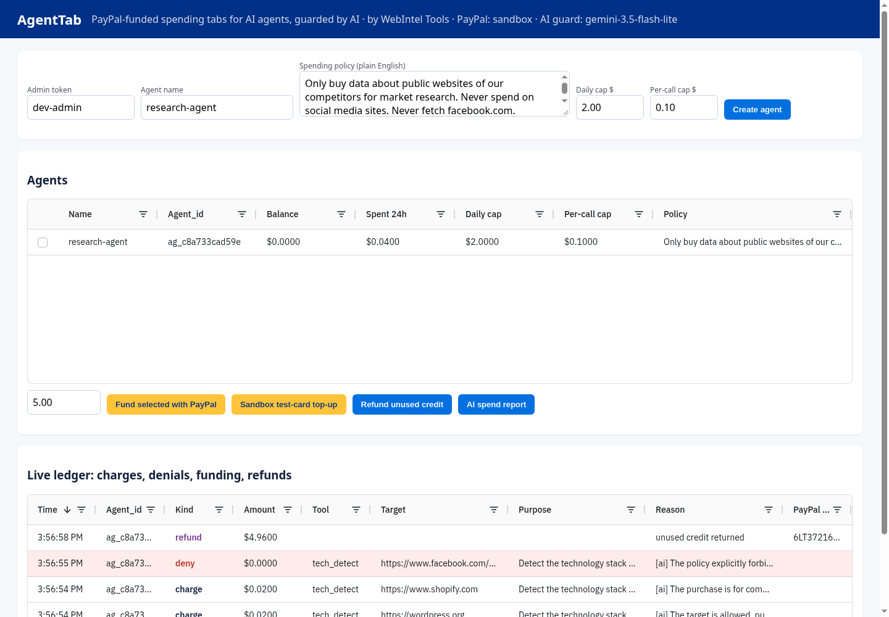

# AgentTab: PayPal-funded spending tabs for AI agents, guarded by AI

AI agents increasingly need to **buy things** (data, API calls, compute), but giving an agent a card is
reckless and approving every $0.02 purchase by hand defeats the point of an agent.

**AgentTab** sits in the middle:

1. **Fund once with PayPal.** The owner tops up an agent's tab through PayPal Checkout (Orders v2:
   create → buyer approves → capture). The agent can also *ask* for more budget: on HTTP `402` it calls
   `/api/me/topup-request` and forwards a PayPal approval link to its human.
2. **The agent spends on its own.** Each paid call (`/api/tools/*`) is metered from the prepaid balance.
   Failed calls are never charged.
3. **An AI spend guard checks every purchase.** The owner writes the policy in plain English
   ("only competitor research, never social media"). Hard limits run first (per-call cap, daily cap,
   balance), then an LLM judges whether the tool, target and the agent's stated purpose fit the policy.
   Denials are logged with the reason.
4. **Full visibility, one-click exit.** A live **AG Grid** dashboard shows every charge, denial, top-up and
   refund. Owners edit policies and caps inline. **Refund unused credit** sends the remaining balance back
   to the payer through the PayPal Payments v2 refund API. An AI spend report summarises behaviour and flags risks.

The paid resources are small web-intelligence tools (page → Markdown, tech-stack detection, SEO audit),
priced from $0.01 to $0.03 per call and published at `/api/catalog` so agents can plan purchases.



## Run it (2 minutes, no accounts needed)

```bash
pip install -r requirements.txt
uvicorn app.main:app --reload            # http://localhost:8000  (admin token: dev-admin)
```
By default `PAYPAL_MODE=mock` simulates PayPal so anyone can try it offline. For the real PayPal sandbox:

```bash
export PAYPAL_MODE=sandbox PAYPAL_CLIENT_ID=... PAYPAL_CLIENT_SECRET=...   # developer.paypal.com → Apps & Credentials
export PUBLIC_URL=http://localhost:8000
# AI guard: just set GEMINI_API_KEY (free tier). Defaults: gemini-3.5-flash-lite, falling back to gemini-3.8-flash.
# Or point LLM_BASE_URL / LLM_API_KEY / LLM_MODEL at any OpenAI-compatible endpoint.
export GEMINI_API_KEY=...
uvicorn app.main:app
```
The guard makes the model answer three separate checks (target allowed, purpose fits policy, injection attempt) and only approves if all pass. Unparseable verdicts are denied. Obvious prompt injection in the agent's `purpose` is rejected before any LLM call. If Gemini is down or rate-limited, it tries the second model, then a transparent keyword heuristic.

### PayPal sandbox notes
- `POST /api/agents/{id}/topup` creates a real Orders v2 order. The buyer approves it on sandbox.paypal.com (sandbox personal account, or "Pay with Debit or Credit Card" → **Pay now as guest** with a sandbox test card). On return, AgentTab captures it.
- `POST /api/agents/{id}/topup-sandbox-card` (sandbox only, refused against live PayPal) creates and captures in one call with PayPal's public sandbox test card. It's for judges and CI who can't click through checkout.
- `agent/approve_sandbox.py` is an experimental headless guest-checkout helper for recordings.

### Try the demo agent
1. Open the dashboard, create an agent, and copy its key.
2. Run:
```bash
python -m agent.buyer_agent --key atk_... --goal "Compare the tech stacks of competitor sites" \
  --urls https://wordpress.org https://www.shopify.com https://www.facebook.com/somebrand
```
3. The agent plans its purchases (with an LLM, if configured), then works through them:
   - Hits `402` and requests a PayPal top-up.
   - After you approve, buys the data.
   - Gets the Facebook purchase **denied** by the guard.
   - Writes a brief.

## API
| Method | Path | Who | What |
|---|---|---|---|
| GET | `/api/catalog` | anyone | Tools and prices |
| POST | `/api/agents` | owner | Create agent (policy, caps) → `api_key` |
| PATCH | `/api/agents/{id}` | owner | Edit policy and caps |
| POST | `/api/agents/{id}/topup` | owner | Create PayPal order → `approve_url` |
| GET | `/paypal/return?token=` | PayPal | Capture (idempotent) → credit |
| POST | `/api/agents/{id}/refund` | owner | Refund unused balance to PayPal |
| GET | `/api/agents/{id}/report` | owner | AI spend report |
| GET | `/api/ledger` | owner | All entries |
| GET | `/api/me` | agent | Balance and caps |
| POST | `/api/me/topup-request` | agent | Ask its human for budget (PayPal link) |
| POST | `/api/tools/{name}` | agent | Paid call: `{url, purpose}`. Returns `402`, `403` (guard) or `200` |

## Safety
- Amounts are stored as integer micro-dollars.
- Capture is idempotent, and an unapproved order is never credited.
- SSRF guard blocks private and metadata IPs.
- Admin and agent keys are separate.
- Every guard decision is logged with its source (`limit`, `ai`, `heuristic`).

## Tests
```bash
pip install pytest && pytest -q     # 13 tests (+1 live: LIVE_AI=1): 402 flow, AI verdicts/fallback/injection, capture idempotency, guard, caps, refunds, SSRF, no-charge-on-failure
```

## Built with
PayPal Orders v2 and Payments v2 (sandbox), FastAPI, AG Grid Community, any OpenAI-compatible LLM
(Gemini 3.5 Flash-Lite by default), and Render (one-click `render.yaml`).

MIT License · © WebIntel Tools
